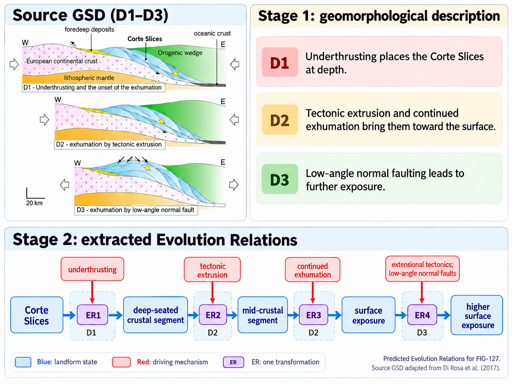

# GSD-HyKE

**Manuscript:** “A process-centered hypergraph data model and extraction
method for landform transformations in geomorphological schematic diagrams”
(submission draft for *Computers & Geosciences*). **Authors:** Yekang Zhou, Teng Zhong, Pei Xu,
Run Shi, Jiahao Sun, Bingxian Lin, Liangchen Zhou, Songshan Yue, and Guonian
Lü. **Contact:** Teng Zhong, tzhong27@njnu.edu.cn. This repository corresponds
to the revised 24-diagram test set and manuscript Tables 3–7.

This repository is the compact public reproduction package for **GSD-HyKE**.
It is intentionally organized around two reviewer-facing tasks: recomputing the
reported test-set metrics from frozen outputs and running the final two-stage
model on the 24 held-out geomorphological schematic diagrams (GSDs).

The release includes the complete 24-diagram test set, rights-reviewed test
images, frozen predictions for the released open-source comparisons and
ablations and four API-model comparisons, two final LoRA adapters, small examples of all data formats, metric
code, and paired-bootstrap inputs. Training-data availability and third-party
licensing are documented in `docs/data_statement.md`.

The task is specific: given one GSD image, its caption, and associated source
context, Stage 1 generates a geomorphological description and evidence
sentences; Stage 2 extracts role-specific Evolution Relations. It is not a
general-purpose chat assistant.

## From a diagram to Evolution Relations
This FIG-127 example shows the two-stage workflow: GSD-HyKE generates a geomorphological description and then extracts connected Evolution Relations from it.


The four relations shown are model predictions; the reference annotation contains three. The Stage 1 text in the graphic summarizes the generated description. Source diagram adapted from Di Rosa et al. (2017), Fig. 8. See the reference annotations, frozen predictions, and image attribution.

## Repository layout

```text
.
├── main.py                    # Small command-line entry point
├── environment.yml            # Conda evaluation/inference environment
├── configs/                   # Effective training-setting specifications
├── schema/                    # Evolution Relation JSON schema
├── examples/                  # Original synthetic diagram and text fixtures
├── scripts/                   # One-command demo and per-table evaluation
├── code/                      # Example, evaluation, inference, and bootstrap code
├── data/
│   ├── examples.json          # Small examples of the five task formats
│   ├── test_gold.json         # Gold annotations for all 24 test GSDs
│   ├── test_images/           # The corresponding 24 test images
│   ├── example_images/        # Images used by the format examples
│   ├── runtime/               # Exact final-model test inputs
│   └── bootstrap_inputs/      # Per-diagram TP/FP/FN tables
├── predictions/               # Frozen description and extraction outputs
├── models/                    # Final Stage 1 and Stage 2 LoRA adapters
├── expected_results.json      # Expected recomputed values
└── tests/                     # CPU-only integrity and unit tests
```

## Quick start

On GitHub, select **Code → Download ZIP** and extract the archive. Open a terminal in the extracted folder containing `main.py` and run:

```bash
python main.py example
```

This example requires only Python. It reads the released prediction for `FIG-041`, reports three Evolution Relations with Input, Output, and Driver fields, and writes the walkthrough to `results/example/FIG-041.json`.

To inspect a different sample or prediction setting, run:

```bash
python main.py example --sample-id FIG-079 --setting table7/without_evidence --output results/example/FIG-079-without-evidence.json
```

## Installation

Follow this section to recompute metrics or run full model inference. Python 3.10 or 3.11 is recommended. If you already downloaded the ZIP for evaluation, use the extracted folder. For full inference, clone with Git LFS to download the two LoRA adapters:

```bash
git lfs install
git clone https://github.com/NNUSCENSLAB/GSD-HyKE.git
cd GSD-HyKE
git lfs pull
```

From the repository root, choose **one** of the following installation methods.

### Option 1: Conda

```bash
conda env create -f environment.yml
conda activate gsd-hyke
```

### Option 2: pip in a virtual environment

```bash
python -m venv .venv
```

Activate the environment with `source .venv/bin/activate` on Linux or macOS, or `.\.venv\Scripts\Activate.ps1` in Windows PowerShell. Then install the dependencies:

```bash
python -m pip install -r requirements.txt
```

Metric recomputation can run on a CPU. On first use, the evaluator downloads SciBERT (`allenai/scibert_scivocab_uncased`) for semantic scoring and, for Table 3, CLIP (`openai/clip-vit-base-patch32`). Local model paths or a populated Hugging Face cache can be used instead.

Full inference requires a CUDA-capable GPU, the Qwen base model (`Qwen/Qwen2.5-VL-7B-Instruct`), and both released LoRA adapters. The 24-diagram run used one NVIDIA A100 GPU with 80 GB of memory, Python 3.10, PyTorch 2.6.0 (CUDA 12.4 build), Transformers 4.49.0, PEFT 0.15.2, and Accelerate 1.7.0. The repository is approximately 185 MiB with both adapters and before downloading the base model.

The reference training software was LLaMA-Factory `0.9.4.dev0`. Full training additionally requires the complete training and validation corpus.

## Quick verification

After installing the dependencies, run these checks from the repository root. The `verify` and `infer --check-only` commands check that the two LoRA adapter files are present.

```bash
python main.py verify
python main.py demo
python -m unittest discover -s tests -v
python main.py infer --check-only
```

## SciBERT demo

After installing the evaluation dependencies, run:

```bash
bash scripts/run_demo.sh
```

The script displays the description, evidence sentence, and Evolution Relations for a synthetic river-valley example in `examples/`. It then scores the same relations against themselves using SciBERT. The expected Relation Relaxed F1 is `1.0000`, which checks that the scoring pipeline runs. To use a local SciBERT model, pass `--model /path/to/scibert`. The relation fields are documented in [`schema/evolution_relation.json`](schema/evolution_relation.json).

The principal public interfaces are:

| Command | Input | Output | Expected behavior |
| --- | --- | --- | --- |
| `python main.py example` | One gold row and one frozen prediction joined by `sample_id` | One walkthrough JSON | Validates and displays the structured Evolution Relations without loading a model |
| `python main.py evaluate` | The 24 gold records and selected frozen prediction settings | `results/recomputed_extraction_metrics.json` | Recomputes Entity/Relation relaxed scores, GED, nGED, ECC, and EPV |
| `python main.py bootstrap` | Four released per-diagram TP/FP/FN tables | Summary CSV and distribution JSON under `results/bootstrap/` | Repeats paired diagram-level bootstrap comparisons |
| `python main.py infer --check-only` | Test inputs, images, and both adapters | Console preflight result | Verifies inference assets without loading the base model |
| `python main.py infer` | 24 images, contextual text, base model, and two adapters | Stage 1 and Stage 2 predictions and metrics under `results/inference_test24/` | Runs the released two-stage model workflow on a CUDA-capable system |

## Recompute extraction results

For a table-oriented entry point, use `python scripts/evaluate.py --table 4`
(or `5`, `6`, `7`). It reads the setting IDs recorded in the released
prediction files, writes a separate JSON result per table under
`results/tables/`, and refuses to overwrite an existing result. For example:

```bash
python scripts/evaluate.py --table 4 --device cpu
python scripts/evaluate.py --table 5 --device cpu
python scripts/evaluate.py --table 6 --device cpu
python scripts/evaluate.py --table 7 --device cpu
```

Use a different `--output-dir` for a second run. `predictions/README.md`
maps each `setting_id` to the relevant manuscript row.

This reproduces the released 24-diagram results using role-constrained
SciBERT matching at the manuscript threshold, `tau = 0.7`:

```bash
python main.py evaluate --setting table5/full_hypergraph --device cpu
python main.py evaluate --setting table5/triplet_reconstructed --device cpu
```

Omit `--setting` to evaluate all released open-source and ablation settings.
The output contains Entity Relaxed F1, Relation Relaxed precision/recall/F1,
GED, nGED, ECC, and EPV. See `predictions/provenance.json` for the setting IDs.

The four API-model rows of Table 4 use a separate sanitized prediction file:

```bash
python main.py evaluate \
  --predictions predictions/api_extraction_predictions.jsonl \
  --output results/recomputed_api_extraction_metrics.json \
  --device cpu
```

All Table 4 rows use the same metric definitions: Entity matching preserves
the Object/Mechanism/Location/Time labels, Relation matching preserves the
Input/Output/Driver/Location/Time roles, and EPV requires Input, Output, and
Driver. The released API records reproduce the selected main repetition for
each model. Frozen parsed outputs support exact metric recomputation;
generating new outputs requires the corresponding API service. See
`predictions/api_provenance.json` for the selected repetition and source hashes.

The Table 5 triplet arm additionally releases the raw triplet text in
`predictions/triplet_raw.jsonl`. Its event reconstruction groups
triples by evidence-sentence IDs and exact Output anchor (or Output alone when
IDs are absent). Recreate the frozen event candidates with
`python scripts/reconstruct_triplets.py`; the 24 reconstructed relation lists
have been checked against the released Table 5 rows. The predefined
reconstruction policy, including its empty-output branch, is documented in
`predictions/triplet_provenance.json`.

Table 3 ROUGE-L, SciBERT BERTScore, and CLIPScore are recomputed with:

```bash
python main.py evaluate --descriptions --setting table3/qwen_gsd_hyke
```

CLIPScore uses `openai/clip-vit-base-patch32` and the manuscript convention
`2.5 * max(cosine(image_embedding, text_embedding), 0)`. The command downloads
both SciBERT and CLIP unless local model paths are supplied with `--model` and
`--clip-model`. Use `--skip-clipscore` only when a text-metric-only run is
intended.

## Recompute paired-bootstrap intervals

```bash
python main.py bootstrap --iterations 10000 --seed 42
```

The resampling unit is the test diagram. Each replicate sums the selected
diagrams' TP, FP, and FN before computing micro Relation Relaxed F1. The three
comparisons share the same paired draws.

## Run final-model inference

First perform a non-GPU preflight:

```bash
python main.py infer --check-only
```

Then run the released Stage 1 to Stage 2 workflow:

```bash
python main.py infer \
  --base-model Qwen/Qwen2.5-VL-7B-Instruct \
  --scibert allenai/scibert_scivocab_uncased
```

Outputs are written to `results/inference_test24/`. Model download and GPU
requirements are the user's responsibility.

## Repository coverage

- This compact repository supports independent metric recomputation from the
  frozen outputs and final-model inference on the released 24-image test set.
- The released Stage 1 and Stage 2 adapters both use LoRA dropout 0.2,
  consistent with the portable configurations and manuscript Table A.1.
- Six relation-negative training records and their use in the 840-row Stage 2
  training sequence are documented in `docs/data_statement.md`.
- The four API-model Table 4 rows can be re-evaluated from the released frozen
  per-diagram predictions.
- Table 3 CLIPScore is reproducible from the released images and frozen Stage
  1 descriptions using the documented CLIP model and formula.
- Frozen predictions support independent evaluation of the triplet and
  ablation comparisons.

These boundaries should also be stated in the manuscript's Code and Data
Availability section.

The training-data coverage and image-sharing rationale are in
`docs/data_statement.md`; the input/output user guide is in
`docs/user_guide.md`.

## Data, licences, and attribution

Original project code is licensed under the MIT License (`LICENSE`). Original
annotations and documentation are released under CC BY 4.0
(`DATA_LICENSE.md`). Diagram images and source text remain subject to their
source-article terms; item-level provenance is in
`data/attribution_manifest.csv` and is explained in
`THIRD_PARTY_NOTICES.md`. The Qwen base model, SciBERT, and LLaMA-Factory retain
their respective upstream licences.

Repository: https://github.com/NNUSCENSLAB/GSD-HyKE

Citation metadata for the submission-stage repository are in `CITATION.cff`.
The final article journal reference and DOI must be added after publication.
